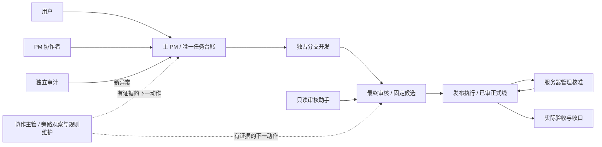
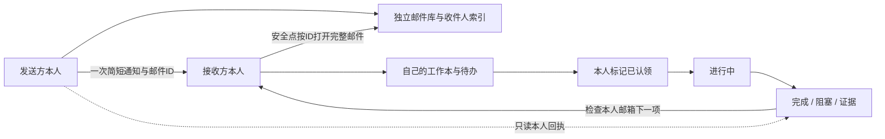

# 多 Agent 协作架构主管

一个面向**负责搭建与维护整个 Agent 团队的协作主管**的 Skill。它把职责、权限、任务台账、消息流、置顶、审核发布和监督规则组织成一套可执行的协作约定。

从实际软件团队的协作方式提炼，适用于需要长期协调开发、测试、审核、部署和项目管理的 Agent 团队。公开内容使用通用角色和示例配置，不包含原项目的会话 ID、服务器、凭据或业务任务材料。

## 架构



主管构建体系并观察它，业务消息直接交真正负责下一步的人。上图是组合模式；采用[产品与调度分离](skills/agent-collaboration-supervisor/references/product-dispatch-parallelism.md)时，产品经理维护需求/决定，独立调度维护已接管任务的执行队列。每项记录保持一个 writer，额外 PM 不共写主台账，审核助手不取得最终批准权。

## 包含的规则

- **角色与置顶**：除代码开发工作会话外，其他角色会话均置顶；无侧栏会话的原生子代理记不适用。置顶不授予权限。
- **消息终止**：一个下一责任人、一次接单回执、禁止 ACK 的 ACK、同证据不重复广播。
- **交付分离**：测试、集成、审核、正式线、管理核准、发布和业务验收分别记录。
- **单一 writer**：一个全局台账、一个目录/分支一个 writer；未知归属不抢占。
- **有界并行**：先有已授权父任务和独立范围，再创建助手；建议总额外助手最多 2 名，需项目实际授权。
- **增量监督**：按游标、覆盖与样本取证，缺测记 unknown，无变化安静；不把等待批准误判为故障。
- **协作成本与模型分层**：只查变化，不为凑满上限读取冷会话；定时器看本人实际义务，模型按用户选择分层，实际配置与质量分别验证。
- **安全交接**：保留原任务、未提交现场、有效窗口与锁，受保护角色不自动轮换。
- **独立邮箱与本人待办**：完整邮件和收件人索引独立于双方工作本，发送者只发短通知；接收者打开完整邮件后本人入待办/认领，不扫描其他Agent记录。
- **主动接单与缺陷闭环**：获授权后配置原生周期启动，跟踪真实收件/认领/行动；Agent发现问题查重建修复单，既定基线bug自主修复到专属审核，生产缺陷实际复核后关闭。
- **产品与调度并行**：按用户选择分离角色；产品经理处理需求和验收，独立调度持续处理ready项，缺产品条件的项不堵住其余队列。原台账需单writer安全交接。

## 持久待办架构



“已存储、已通知、已打开、本人入待办、已认领、实际动作”分别记录。日记/事件由本人维护；主管只登记路径和路由。全局执行台账由组合模式的主 PM 或分离后已接管该任务的调度唯一维护。产品、用户、需求、模块新增也可记录为本人的分类事件并引用原授权。

记录按 **日期 → 类别 → 处理项 → 分页** 分类：每页最多50条事件，根文件只列最近20天索引，不向一个文件无限追加。当前协作架构优先于旧全局默认；代码测试后只集成预备线，main 由指定审核者晋级。

[独立邮箱协议与CLI](skills/agent-collaboration-supervisor/references/mailbox-transport.md)包含完整邮件存储、短通知、按ID打开和本人入账；[个人工作本](skills/agent-collaboration-supervisor/references/durable-workbooks.md)保留分类与恢复约定。新收件只查本人邮件索引，无须扫描所有Agent记录或新增逐角色收件timer。工具不自行发聊天/启动Agent；原生通知由发送方按现有授权执行。规则、隔离测试和实际角色接入分别验收。

## 使用

Skill 入口：[SKILL.md](skills/agent-collaboration-supervisor/SKILL.md)。

把仓库中的 `skills/agent-collaboration-supervisor` 整个目录复制到你的 Skill 目录（Codex 常见位置为 `~/.codex/skills/`），保留 `references`、`assets` 和 `agents`。在支持的客户端中刷新或开始新会话后调用：

```text
使用 $agent-collaboration-supervisor 为这个项目建立多 Agent 协作体系。
先核对现有角色，补齐主管、主 PM、审核、服务器管理、发布和审计。
除代码开发工作会话外，其他角色会话都置顶。
保留现有任务和负责人；先交付权限、路由和可验证的搭建结果。
```

已有团队也可只要求一个明确范围：

```text
使用 $agent-collaboration-supervisor 分析现有团队的重复确认和审核等待，
只读相关任务与消息元数据，给出证据和规则修改建议，不创建新会话或定时任务。
```

创建会话、跨会话发送、定时运行、写入服务器和公开资料分别遵循用户实际授权。Skill 提供规约与模板；工具能力、账号隔离和服务端强制门禁需要在使用环境中单独核实。

## 文件导航

| 文件 | 用途 |
|---|---|
| [SKILL.md](skills/agent-collaboration-supervisor/SKILL.md) | 主管工作入口、模式、核心约束和验收 |
| [角色与消息协议](skills/agent-collaboration-supervisor/references/roles-and-routing.md) | 职责矩阵、路由、任务视图、消息与交付清单 |
| [搭建与交接](skills/agent-collaboration-supervisor/references/bootstrap-and-handoff.md) | 创建/复用角色、置顶、独占根和代际交接 |
| [监督与并行](skills/agent-collaboration-supervisor/references/supervision-and-parallelism.md) | 覆盖/指标、就绪委派包、助手容量与串行门禁 |
| [模型与成本](skills/agent-collaboration-supervisor/references/model-and-cost-policy.md) | 差量采样、本人义务启停、模型实际采用与真实用量 |
| [配置样例](skills/agent-collaboration-supervisor/assets/collaboration-config.example.json) | 中性草案，不含真实身份；自动化/并行/继任默认未启用 |
| [工作本协议](skills/agent-collaboration-supervisor/references/durable-workbooks.md) | 本人维护、分类、认领与恢复 |
| [独立邮箱](skills/agent-collaboration-supervisor/references/mailbox-transport.md) | 邮件库、收件索引、短通知、打开后本人入账 |
| [本地工作本工具](skills/agent-collaboration-supervisor/scripts/workbook.py) | Python 标准库实现，只操作获准本地记录 |
| [产品与任务调度并行](skills/agent-collaboration-supervisor/references/product-dispatch-parallelism.md) | 角色分离、就绪卡、独立队列与存量单writer交接 |

工作本及调度原语测试：`python -m unittest discover -s skills/agent-collaboration-supervisor/scripts -p "test_*.py" -v`。隔离文件系统测试与真实Agent派单分开验收。

[主动接单与缺陷闭环](skills/agent-collaboration-supervisor/references/proactive-intake-and-defect-loop.md)提供周期消费、5/10分钟目标、异常恢复和自主/人类决策边界；[只读流程检查器](skills/agent-collaboration-supervisor/scripts/task_flow.py)验证分流、时限和关闭证据缺项，不执行任务或授予权限。

MIT License。
