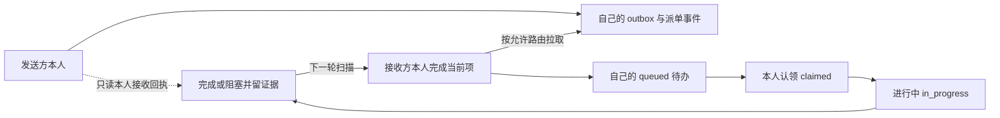

# 持久工作本：发送方发布，接收方本人扫描入账

适用于持久待办、避免打断工作、可恢复认领和逐 Agent 记录。逻辑路由仍按原角色协议；传递方式不扩大任何产品或服务器权限。

## 写入边界

**每个 Agent 只写自己的工作本。** 发送方在自己的 outbox 发布请求并记录派单；目标 Agent 在启动、当前项结束/明确阻塞、安全交接点扫描允许联系者的 outbox，亲自写入自己的 inbox、事件、状态和日记。其他 Agent、PM、主管均不能代写目标 Agent 的待办或假冒认领。

主管管理位置/路由登记和只读覆盖；主 PM 唯一写全局任务台账。个人记录引用原 task_id，不另造全局需求总表。产品、用户、需求和模块新增由对应业务 owner 留本人事件和原授权指针；请求落盘不是需求已批准。



## 位置与权威

主管指定产品 checkout、PM 台账之外的本地运行根：

```text
workbook-root/
  registry.json                 主管登记真实角色与允许路由
  agents/AGENT-ID/
    owner.json                  该 Agent 本人 init，未知 owner 不覆盖
    outbox/YYYY/MM/DD/MSG.json  本人按日期发布的不可变请求/结果
    inbox/SENDER/YYYY/MM/DD/MSG.json  本人扫描后写入的待办副本
    events/YYYY/MM/DD/SEQ.json  本人不可变事件，事实来源
    state.json                  本人生成的状态快照
    WORKLOG.md                  最近20个日期的短索引，不累计正文
    days/YYYY/MM/DD/INDEX.md    当日分类导航
    days/YYYY/MM/DD/CATEGORY/part-001.md  每页最多50事件
    tasks/WORK-ID/YYYY-MM-DD-001.md      每处理项按日分页
    .writer.lock                单次本人写入互斥，不是生产锁
```

登记位置不等于已接入；本人 init/扫描证据齐备才标 enrolled。后继用自己的真实 ID 和新工作本，引用前代并按原规则交接。actor 参数是协作身份声明，**不构成 OS 账号隔离**；共享账号仍能绕过规约，不能声称强制身份隔离。

分类是硬约束：日期 → system/inbox/dispatch/work/product/user/requirement/module/risk → 分页，并按 work_item 保留独立任务页。每页最多50事件，每条 note/result 最多8 KiB，长材料只放证据指针。根索引只含最近20天入口；不可变事件按日存放，不无限追加单文件。登记的 calendar_utc_offset_minutes 决定归档日期，默认UTC；项目明确采用固定时区时配置实际偏移及说明，不能把UTC日期误称本地日期。存在夏令时的项目须在切换前由登记维护者核对偏移；本工具不提供自动时区数据库同步。

## 工具与执行循环

[workbook.py](../scripts/workbook.py) 只依赖 Python 标准库，不联网、不发聊天、不启动 Agent、不执行业务动作。在已授权路径使用；[登记样例](../assets/workbook-registry.example.json)和[消息样例](../assets/workbook-message.example.json)只供生成实际输入。

1. 主管填真实 ID/角色/路由后首次 configure。更新已有登记必须指定原 manager 的 --actor，经其本人操作锁核对并保留 registry-history；不能借配置更换负责人或另造根绕过归属。
2. 每个参与者**本人** init；每次启动先 scan。发起者 send 只写自己的 outbox。
3. 接收者 scan 后检查原批准范围，再 claim；越权请求 rejected。认领不是授权。
4. 标 in_progress 执行限定工作；完成或 blocked 时记录证据、缺项/解除条件与下一 owner。反馈由本人 send 到自己的 outbox，按原角色路由供对方拉取。
5. 每项完成/阻塞后再 scan，有就绪项继续；最终退出前再 scan，无待办才结束，不轮询整段聊天。

```sh
python workbook.py --root /approved/workbooks configure --config registry-input.json
python workbook.py --root /approved/workbooks --actor AGENT-ID init
python workbook.py --root /approved/workbooks --actor SENDER-ID send --message request.json
python workbook.py --root /approved/workbooks --actor AGENT-ID scan --limit 20
python workbook.py --root /approved/workbooks --actor AGENT-ID claim --message-id MSG-EXAMPLE-001
python workbook.py --root /approved/workbooks --actor AGENT-ID transition --work-item WORK-EXAMPLE-001 --status in_progress --result '原范围已核对'
python workbook.py --root /approved/workbooks --actor AGENT-ID transition --work-item WORK-EXAMPLE-001 --status completed --result '实际证据路径'
python workbook.py --root /approved/workbooks --actor AGENT-ID scan
python workbook.py --root /approved/workbooks --actor SENDER-ID receipts
```

ID 仅用字母/数字/短横线/下划线，避免 Windows 文件名问题。旧消息 ID 可存 legacy_message_id；work_item_id 标识一次独立处理步骤，task_id 引用原业务任务。补证/审核结果可有新处理步骤，不虚增业务 TASK，不换消息 ID 重派同一 work_item。

## 状态与恢复

| 状态 | 证明来源 | 含义 |
|---|---|---|
| awaiting_recipient_scan | 发送方 outbox/派单事件 | 已发布但对方未扫入，不能说已收到 |
| queued | 接收方本人 queued 事件 | 已写入本人待办，尚未执行 |
| claimed / in_progress | 接收方本人认领/状态事件 | 已认领/正在处理 |
| blocked | 接收方本人阻塞事件 | 保留进度、缺项、解除条件及下一 owner |
| completed / rejected / cancelled | 接收方本人终态与证据 | 本步骤收口，业务整体另按原验收 |

send 不写别人目录。本人 busy 时 scan 只返回延期和数量，不导入第二项。note 记录 work/dispatch/product/user/requirement/module/risk 及原授权/需求指针，默认关联当前已认领处理项；无当前项时可用 --work-item 显式关联既有项。旧笔记没有结构化处理项时保留未关联事实，不从正文猜归属。receipts 只读对方本人事件，不另发 ACK，不假造“收到”。

消息完整落盘后原子发布，同 ID 同内容重试幂等，同 ID 不同内容拒绝；同 work_item 不重复执行。崩溃后 status 从不可变事件重放，本人 init 可重建 state.json/WORKLOG.md。若已 claimed 而执行结果未知，先核对实际效果再恢复；工具不承诺外部业务 exactly-once。

Windows等环境可能拒绝替换正在被读取的派生页。投影仅在字节变化时原子替换，权限/共享拒绝最多尝试3次（间隔0、50、150毫秒）；不把该策略用于原始事件、消息发布、registry、锁或业务动作。拒绝来源仍须实际证据核对，不自行改ACL或关闭用户程序。

若事件已提交但派生页仍失败，API/CLI返回`operation_status=committed_projection_pending`、`canonical_event_committed=true`、确切`committed_event_sequences`及`projection_status=pending`。本机事件提交返回成功不表示派生页、外部业务或完整验收成功；不能据页面未更新而重发、重认领或重做业务。先用`status`/`receipts`从不可变事件核对，再由本人在后续检查点`init`重建。直接读取state.json或Markdown须与原始序号核对，滞后投影不等于未接收。

已有owner的重建若仍失败，返回`projection_pending_no_new_event`和`canonical_event_committed=false`，仅表示本次未新增事件，不推翻此前已提交的认领。原始事件读取失败/序号冲突、未知owner/锁及registry替换失败仍是硬错误，不能降级为投影提示。投影恢复不追加新业务事件，不声称外部exactly-once。

未知 owner、已有锁、损坏事件、路径/路由不符均保留并报错，不按锁龄删锁。使用同文件系统原子硬链接发布，先测试目标文件系统能力；不可用则阻断，不降级为半文件可读写入。

试行期间必须固定受测的不可变工具版本，不能执行会被分支更新替换的脚本。旧客户端若忽略日期目录，可能制造重复序号；检测到冲突立即保留原始事件，不自动选边。已确认的单条重复note，只能由本人核对原字节、时间和业务事件后可逆归档并补关联说明；未知冲突保持blocked。代码版本、工具配置和本人记录一致后才能扩大试行。

## 空闲空窗与试行

普通消息不打断 busy Agent。首次接入只能在确认已收口/等待分工时发一次控制通知，指向工作本和原范围；不为告知协议打断工作。原生无持久会话子代理仍可本人写独占工作本，退出后的未扫消息按业务交接处理。

**文件不会自动唤醒已结束会话，也没有原生每轮结束强制钩子。** 最后一次扫描后的新消息继续留在发件簿，等下次启动或已获授权的原有 heartbeat 补扫。需要及时空闲唤醒时另查条件唤醒能力；工具没有原子 idle-and-send 就不能保证状态检查后不会变 busy。不得声称已实现自动守护或自动新增轮询计划。

审批撤回、窗口到期和锁有效性仍在每次获准副作用前核查；普通队列不延长许可。既有明确授权的紧急停写通道按原安全规则保留，不把催办伪装成安全通知。

先测文件系统行为，再选已空闲、范围独立的少量 Agent 真实试行：第一项已认领进行中时，发送方仅新增自己的第二项 outbox；验证目标工作本未被外人改变，第一项完成后由目标本人扫入第二项、认领并记录完成/阻塞。其余角色保留 pending_adoption，不能报全量生效。
