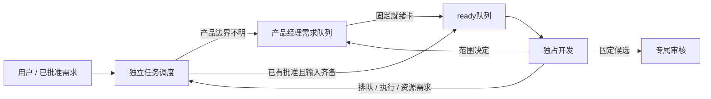

# 产品管理与任务调度并行

当用户要求产品经理与派单并行，或实际证据表明长时间协调工作阻塞已就绪任务时，采用本模式。先核对具体队列、范围缺口及实际动作；UI工作中、idle或未读标记本身都不能证明卡死或空闲。

## 两条职责线

| 角色 | 独占职责 | 不代行 |
|---|---|---|
| 产品经理 | 需求目标/非目标、产品范围、验收、跨模块/权限/API/计费等必要决定、就绪需求卡 | 执行调度台账、服务器核准、代码与发布 |
| 任务调度 | 新增需求入口、就绪队列、模块owner/容量、独占目录核对、派单/去重、执行回执、资源申请归并 | 自批不明产品范围、main、服务器变更、替产品经理确认关键需求 |

默认组合模式的PM职责只在未启用分离时适用。采用分离后，明确产品台账与执行台账的唯一writer/权威路径，不能把“两人都能写所有tasks”称为并行。原PM协作者保留原任务，只有用户明确选择改任时才交接。新调度作为非代码开发角色置顶；最终审核、服务器管理、发布、审计、主管原职责和安全边界不变。

产品经理可继续长分析或澄清；调度同时处理独立的ready项。一个needs_product_decision/blocked项不阻塞整个队列。产品经理输出就绪卡后不再逐次ACK调度；普通消息仍为本人outbox、接收方本人检查点扫描，不即时打断忙碌角色。

## 就绪与派单边界

每项至少记录：原task_id、确切用户批准来源/就绪卡版本、目标/非目标、可观察验收、所属项目/模块、真实owner与容量、依赖、允许写入范围/独占路径、结果接收者和停止条件。候选/测试/资源窗口涉及什么就引用对应确切证据。

直接来自用户、范围和验收已明确的已有修复可按原授权进入ready；不能从其他Agent概述、旧截图、未处理聊天或“着急”推导新产品批准。关键条件不明时needs_product_decision，写具体缺项/解除owner，同时继续其他ready项。入口属于哪个项目、代码owner是谁尚未核实，仍是缺口，不能靠新增调度角色掩盖。

调度认领卡后先核对同task/处理步骤是否已派单、开发的真实目录/分支/容量、是否已在执行。派单和结果写调度本人的工作本/执行记录；产品经理读事实更新产品记录，不共写调度文件。开发的范围问题交产品经理，代码补证仍直接交专属审核，资源申请经调度归并后交服务器管理。派单不是服务器核准或发布许可。

## 单writer台账与存量交接

分离模式配置必须区分 product_root、dispatch_root、owner ID、每task execution_owner 和 authority_pointer。产品经理独占产品/需求/决定；调度独占其已接管的queue/tasks/assignments/执行进度。主视图只能引用另一方事实，不能生成第二份可独立编辑的同任务状态真相。

先以新就绪项小范围试行。存量任务仍归原writer，等待其安全点给出固定清单、最后事件、停写和接管证明；原事件/意图路径/累计计数/开发现场/许可窗口保留。没有交接不能夺取旧协调根、迁移全部tasks，不能因PM忙碌、超时或clean status猜它已停写。调度根由登记的调度本人O_EXCL建owner；主管只登记位置，不代建其日记。

新增调度会话须有用户创建授权；改任已有PM须用户明确选择并完成原任务交接。角色安排未定时，先交可审查方案/固定范围和隔离验证，不擅自改任或覆盖owner。受保护角色不因此换人，自动继任范围也不由新角色名称自行扩大。

## 试行与验收

1. 在隔离的本地文件系统中，产品经理保持一项in_progress，调度本人仍能扫描已批准就绪卡、认领并持久派给开发；产品经理目录不被调度改写。
2. 同时有缺关键产品条件的项与ready项，前者本人blocked并把问题放本人outbox给产品经理，后者继续派单。
3. 派单发布不等于开发已收到，开发本人scan/claim才有回执；同ID/同work_item不重复执行。
4. 真实试行只用明确就绪、已授权的独立工作，不为展示并行编造产品需求或重启已完成任务。
5. 存量台账未迁移的边界、角色创建/置顶、真实派单与隔离模拟分开报告。只到pre-main交专属审核，不由开发自行晋级main。

上述测试验证工作本的独立队列原语，产品范围/就绪判定仍需角色按实际授权核对；不是二进制权限引擎，也不能拦截客户端中尚未被处理/发布的聊天。需要及时进入新队列的需求，应直接交调度入口或由产品经理在检查点发布就绪卡。
