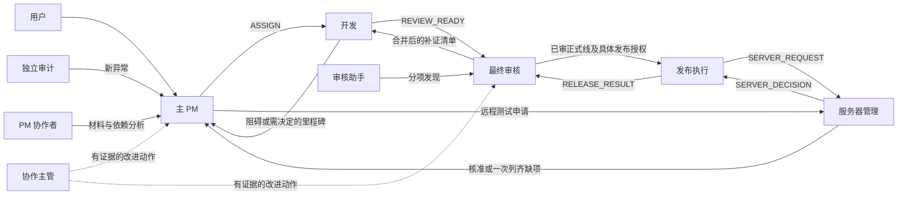

# 角色、状态与消息协议

本页的主 PM 兼管产品与调度表述适用于组合模式。用户启用[产品与调度分离](product-dispatch-parallelism.md)后，产品需求/决定仍归产品经理；已明确交接的执行队列、派单与进度归独立调度。每个 task_id 的执行 authority_pointer 只有一个 writer，未交接旧任务仍归原 owner。该模式的分工覆盖本页组合模式路由，不改变审核、服务器管理和发布门禁。

用于建立或纠正角色边界和消息链。先复用项目现有登记，不把下表当作更换负责人的批准。

下文“发/交”对新消息指提交[独立邮件库](mailbox-transport.md)，发送方用短通知定向告知邮件ID/位置，接收方打开后本人入[个人工作本](durable-workbooks.md)。邮件不放双方待办充当消息服务；接收方仅查自己的邮箱，不扫描其他Agent记录。本人接收/认领事件代替即时ACK。原路由和唯一next_owner不变；busy角色到安全检查点读邮箱，旧消息按原ID有界收口。

## 职责与置顶矩阵

| 角色 | 负责的决定或产物 | 不代行 | 置顶 |
|---|---|---|---|
| 用户 | 目标、范围、高风险取舍、具体发布授权和负责人变更 | 角色设立不代替每次实际操作授权 | 若有独立协调会话则置顶 |
| 协作主管 | 建立规则/登记、路由一致性、增量观察、受限并行安排 | 产品决策、全局派单台账、最终审核、生产执行 | 是 |
| 主 PM | 需求确认、模块路由、任务队列、唯一全局台账、依赖协调 | 开发、代码审核、服务器核准 | 是 |
| PM 协作者 | 指定任务的事实、验收草案、依赖和排期材料 | 共写主台账、重复派单、自动继任 | 是 |
| 开发 | 独占分支实现、测试、文档与候选交付 | 最终批准、绕过集成线部署 | 默认否 |
| 最终审核 | 审查固定候选及证据、合并问题清单、批准和晋级正式线 | 自行发布、以缺测代通过 | 是 |
| 只读审核助手 | 独立专题审查、自己的发现报告 | 批准候选、改产品、直接催发布 | 是；原生无会话则不适用 |
| 服务器管理 | 审核操作对象、执行者、窗口、预算、回退和锁安排 | 因资源核准替代产品审核或用户授权 | 是 |
| 发布执行 | 按已审正式线和具体核准持锁发布/回退、收口验收 | 自批候选、修改产品以绕过门禁 | 是 |
| 独立审计 | 只读生产证据、覆盖和趋势、新异常 | 自行修复、部署、有副作用探针 | 是 |
| 独立测试/验收 | 指定环境与候选的验证及结果 | 把测试许可升级成共享环境变更许可 | 是；若实际承担编码则按开发会话 |

项目可以合并低风险辅助职责，但不能默认合并最终审核与发布、管理核准与未经授权执行。多个 PM 并存时，主 PM 仍只有一个；协作者局部草案不构成第二套全局台账。

## 标准有向路由



主管按实际问题选择一个接收者，图中虚线不表示每次双投。普通结果不抄送主管。跨开发者沟通由 PM 在任务中指明双方、问题、期限和允许联系对象。业务 owner 需要协调时直接发明确请求；接收者执行后回实际结果，无需先 ACK。

## 单一任务视图

每个独立交付单元一个稳定 task_id。追加查询、测试重试、消息补证和同目标续作不新造任务。主 PM 保留原始事件，原子更新视图；开发/审核/发布证据仍由各 owner 确认，PM 不能通过更新字段自行批准。

必要语义：

```json
{
  "task_id": "TASK-EXAMPLE-001",
  "goal": "用户批准的可验证结果",
  "phase": "review",
  "status": "waiting_evidence",
  "owner_role": "developer",
  "owner_thread_id": null,
  "worktree_realpath": null,
  "branch": null,
  "source_sha": null,
  "integration_sha": null,
  "review_state": "changes_requested",
  "main_sha": null,
  "release_state": "not_authorized",
  "blockers": [{"reason": "缺少行为证据", "owner_role": "developer", "clear_when": "固定候选的结果齐备"}],
  "next_owner": "developer",
  "next_action": "提交本轮候选的指定行为证据",
  "evidence_index": [],
  "authorization_refs": [],
  "management_approval_refs": [],
  "last_event_id": null,
  "updated_at": null
}
```

null 表示未核实，不是默认空闲。phase 可映射 intake/development/verification/integration/review/main/release/acceptance/closed；沿用项目既有 status 枚举。闭环后 next_owner=null、next_action=none。拆分并行分项时保留父 task_id 和各自 owner，不复制整份任务历史。

## 消息封套与终止

消息用项目既有格式；至少保留下列语义：

```json
{
  "protocol": "agent-collaboration/v1",
  "message_id": "TASK-EXAMPLE-001:developer:0004",
  "task_id": "TASK-EXAMPLE-001",
  "type": "REVIEW_READY",
  "from_role": "developer",
  "to_role": "reviewer",
  "candidate_sha": null,
  "summary": "本次范围、实际结果及仍需处理的缺口",
  "evidence": ["review-package-path"],
  "requires_action": true,
  "next_owner": "resolved-reviewer-id",
  "next_action": "审查固定候选并一次给出完整结论",
  "reply_to": null
}
```

这些是语义示例，实际投递前填真实角色 ID、候选和证据，不能把示例当成已投递事件。源提交、集成提交、正式线提交、tree、image digest 和测试快照分别记录。

消息只交需要行动的人。初次 ASSIGN 或真实 HANDOFF 允许一次 requires_action=false 的 ACK，记录后即终止；一次获用户授权的规则告知也不索取回执。其余无待办 INFO/PROGRESS 优先落记录。短消息建议 5–10 行，完整报告用指针；必要复杂核准保留足够范围，不能为长度删掉安全条件。

同任务/候选/证据/阻碍版本未改变时不重复发。更正新建 message_id 并 reply_to 原事件，只交受影响的下一 owner。发送失败核对投递记录后至多同 ID 重试一次，随后保留 delivery_unknown。投递成功与业务完成分别记，不能索取第二次收件确认。

普通进度仅在确有排期动作时合并发送，可采用同任务 30 分钟至多一条的上限；这是降频上限，不是周期群发要求。新阻碍、审批撤回、实质失败、完整交付和安全窗口风险不受该等待限制。

## 门口交付清单

| 交接 | 证据必须能回答 |
|---|---|
| PM → 开发 | 原需求/范围/非目标、独立 TASK、验收、依赖、独占目录与分支、允许联系人 |
| 开发 → 审核 | 固定 source/integration SHA、原需求、实际差异、CHG/决策记录、测试结果/失败/unknown、兼容及回退 |
| 审核 → 发布 | 已审正式线 SHA、组件/制品、用户的具体授权、证据、迁移/数据/回退边界 |
| PM/发布 → 管理 | 环境、确切操作/对象、执行者、窗口、预算、依赖、收尾和回退；申请不是批准 |
| 管理 → 申请者 | approval ID/revision、确切范围、有效窗口、撤销条件和项目锁安排 |
| 测试/发布 → 收口 | 来源与实际对象、收集/通过/失败/跳过、setup error 与业务断言区分、实际后值、锁/资源终态 |

缺少交付材料时一次列齐具体缺项，等待原 owner 补齐。不可通过反复申请同一个未就绪包、盲重跑、旧测试数字或更换执行者绕过缺口。

## 分离模式的主动责任

启用独立调度后，PM及PM协作者不再为新任务承担执行派单职责，未交接旧TASK保留原writer；以[产品分离](product-dispatch-parallelism.md)和[主动接单与缺陷闭环](proactive-intake-and-defect-loop.md)为准。审计/审核/开发等发现独立缺陷，DEFECT_REPORT直接交调度查重建单；同候选审查意见仍直接回原开发。恢复既定基线的bug可自主走开发→专属审核，不把PM忙碌作为前置条件；生产权限另行核准。

## 单项受限联系

已有owner明确授权一条跨执行者联系，且普通全局pair路由不存在时，原registry manager可登记task_scoped_routes，必须固定sender/recipient、task_ids、message_types、work_item_ids、authorization_ref及active/revoked状态；没有空集合或通配符。它不增加业务/产品/服务器权限，也不把一个问题升级为永久联系许可。

```json
{
  "grant_id": "ROUTE-EXAMPLE-001",
  "sender": "UI-OWNER",
  "recipient": "MANUAL-OWNER",
  "task_ids": ["TASK-EXAMPLE-001"],
  "message_types": ["COORDINATION_REQUEST"],
  "work_item_ids": ["WORK-MANUAL-DEPENDENCY-001"],
  "status": "active",
  "authorization_ref": "fixed owner-approved dependency package"
}
```

使用同一个已审冻结mail_transport.py/workbook.py配对；新受限路由只通过AgentMail.send投递，不用旧outbox send/跨发送者scan。工具逐封核对当前登记，错TASK/类型/处理项、反向发送、撤销后新操作拒绝。限定pair不能同时留在无限制allowed_routes中冒充窄授权。完成、取消、撤回或固定问题范围结束，由原manager据实际证据撤销；不是自动业务停机或生产授权。已有业务owner仍检查TASK/许可当前有效性，未知不猜或转抄正文绕路。
